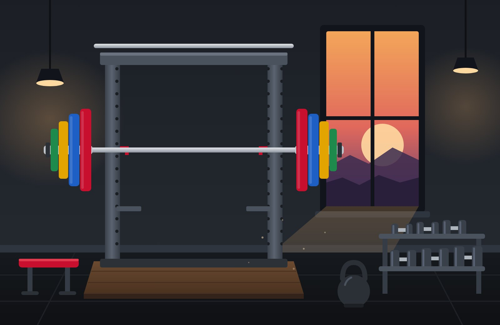

# RepWise



A workout, diet and progress tracker with an AI weekly coach. There's no app to download. It's one website: log in and start logging, on iPhone or Android.

## The problem

Tracking your training shouldn't take more effort than the training.

- Most gym trackers want you to download an app, create an account and start a subscription before you can log your first set.
- Workouts end up in one app, meals in another and progress photos in your camera roll, so nothing shows you the whole picture.
- The logs pile up, but nobody reads them and tells you what to change next week.

## How I'm fixing it

RepWise is just a website. Open the link, log in and start logging.

- **Nothing to install.** It runs in the browser on iPhone and Android. If you want an icon, you can add it to your home screen.
- **Everything in one place.** Workouts, cardio, diet with food photos, body weight and progress photos.
- **A coach that reads your week.** Every Sunday an AI reviews your logs and gives you a few specific things to do next.
- **Works in the gym.** With no signal, your log saves on the phone and uploads when you're back online.
- **Free to run, and yours.** It runs on the free plans of Cloudflare and Groq, and your data stays in your own account.

## Who can use it

Anyone with a phone and a browser, whether you lift, run or are just getting started. It works on iPhone and Android, and on tablets and laptops too. You don't need to know how to code: the setup below takes about 20 minutes in your browser.

Each RepWise site has one password and one log, so it's built for one person. If a friend wants to use it, they set up their own copy and get their own private site.

## What's inside

**Workouts, logged like the best gym apps**
- Search 870+ exercises with photos, instructions and muscle groups, filter by muscle or equipment, or add your own
- Log each set with weight and reps, a **Previous** column showing last time, and a checkmark when it's done
- Set types: **Warm-up** (left out of volume and records), **Normal**, **Drop set** and **Failure**
- Bodyweight exercises (with optional added weight) and timed exercises like planks
- Rest timer that starts when you check off a set, with a sound when it ends
- Workout timer, volume and set counts, and automatic personal records (best estimated 1-rep max, heaviest weight, most reps, longest hold)
- Edit, repeat or delete past workouts, plus progress charts for every exercise

**Everything else**
- Cardio, meals with photos, calories and protein, weigh-ins and progress photos with side-by-side compare
- An AI coach that reviews your week every Sunday at 9 pm IST
- Works offline in the gym: workouts save on the phone and upload when you're back online
- Only you can log in. Photos are private and never sent to the AI.

**Cost: $0/month.** Cloudflare's free plan covers the website, the database (5 GB) and photo storage (10 GB). Groq's free plan covers the AI.

---

## Setup (about 20 minutes, all in your browser)

You don't need to install anything. You'll use GitHub to hold the code and Cloudflare to run it. Every time the code on GitHub changes, Cloudflare updates your site automatically.

If a button label in Cloudflare looks slightly different from what's written here, look for the closest match. Their dashboard changes from time to time.

### 1. Copy the code to your GitHub
1. Sign up free at https://github.com if you don't have an account.
2. Click **Fork** at the top of this page, then **Create fork**. Keep the name `repwise`.

### 2. Create the database
1. Sign up free at https://dash.cloudflare.com/sign-up and log in.
2. In the left menu open **Storage & Databases → D1 SQL Database** and click **Create database**.
3. Name it `repwise-db` and click **Create**.
4. Copy the **Database ID** shown on the next page (it looks like `a1b2c3d4-5678-...`).
5. Back on GitHub, open `wrangler.jsonc`, click the **pencil** icon to edit, and replace `PASTE-YOUR-DATABASE-ID-HERE` with your ID. Keep the quotes. Click **Commit changes**.

You don't need to create any tables. The app creates them the first time it runs.

### 3. Create photo storage
1. In Cloudflare open **Storage & Databases → R2 Object Storage**.
2. If asked, enable R2 on the free plan. It may ask for a card; you're only charged if you go over 10 GB.
3. Click **Create bucket**, name it `repwise-photos`, and click **Create**.

### 4. Connect GitHub and deploy
1. Open **Workers & Pages** and click **Create application**.
2. Choose **Import a repository** (GitHub), sign in to GitHub when asked, and allow Cloudflare to see your `repwise` repository.
3. Select `repwise`. Keep the project name as `repwise` (it must match the name in `wrangler.jsonc`), leave the build settings as they are, and click **Deploy**.
4. When it finishes, it shows your site address, like `https://repwise.yourname.workers.dev`.

### 5. Set your password and AI key
In your `repwise` Worker, open **Settings → Variables and Secrets** and add these three, each with type **Secret**:

| Name | Value |
|---|---|
| `APP_PASSWORD` | The password you'll log in with. Make it long. |
| `SESSION_SECRET` | Any long random text, at least 32 characters. Mash the keyboard or use a password generator. |
| `GROQ_API_KEY` | Sign up free at https://console.groq.com, open **API Keys**, create a key and paste it here. Skip this if you don't want AI reviews. |

Click **Deploy** (or **Save and deploy**) after adding them.

### 6. Open it on your phone
Open your site address in your phone's browser and log in. That's all you need to start logging.

To get an icon on your home screen as well:
- **iPhone (Safari):** tap **Share → Add to Home Screen → Add**.
- **Android (Chrome):** tap **⋮ → Add to Home screen** or **Install app**, then confirm.

Tap the gear on the Today screen to set your goal, calorie and protein targets, and kg or lb.

Done. The first time you add an exercise, the app downloads the exercise list (a few seconds), then it's instant.

---

## Working on the code in VS Code (Windows)

You need [Git](https://git-scm.com/download/win), [Node.js LTS](https://nodejs.org) and [VS Code](https://code.visualstudio.com).

**Run RepWise on your laptop**
1. In VS Code: **File → Open Folder** and pick the `repwise` folder. Click **Yes, I trust the authors**.
2. Open the terminal with **Ctrl + `** and run `npm install`.
3. Copy `.dev.vars.example` to a new file named `.dev.vars` and set a password in it.
4. Run `npm run dev`, then open http://localhost:8787 in your browser and log in.

Data you log here is stored only on your laptop (in the hidden `.wrangler` folder), separate from your real app. Press **Ctrl + C** in the terminal to stop.

**Send changes live:** in the **Source Control** panel (left sidebar), type a short message, click **Commit**, then **Sync Changes**. Cloudflare redeploys in about a minute.

**Files you'll edit most:** `public/` for screens and styles, `src/worker.js` for the server, `wrangler.jsonc` for settings.

---

## Using it

- **Start a workout:** tap **Start a workout** on Today, or **+ → Workout**. Search and tap exercises to select several, then **Add**.
- **Log your diet:** tap **+ → Diet**, take or choose a food photo, and add calories and protein if you know them.
- **Log a set:** type weight and reps, then tap the checkmark. If you leave them empty, checking the set uses what you did last time (shown in grey).
- **Change set type:** tap the set number (1, 2, 3) to make it a Warm-up, Drop set or Failure set, or to remove it.
- **Copy last time:** tap the grey **Previous** value.
- **Rest timer:** tap the blue timer on an exercise to change it or turn it off.
- **How to do an exercise:** tap its photo or name.
- **Leave the workout running:** tap the down arrow at the top. A red bar lets you jump back in.
- **Finish:** tap **Finish**. You'll see your new records.
- **Compare progress photos:** in Photos, long-press two photos.
- **Backup:** Settings → **Export all logs**. Do this every month or two.

## Changing things later

Edit files directly on GitHub (pencil icon) and commit. Cloudflare redeploys automatically in about a minute.

- **Review day/time:** `"crons"` in `wrangler.jsonc`. Times are UTC, so subtract 5:30 from IST (9 pm IST is `30 15 * * SUN`).
- **AI model:** `"GROQ_MODEL"` in `wrangler.jsonc`.
- **Change password:** edit the `APP_PASSWORD` secret in Cloudflare. This also logs every device out.
- **Log everyone out:** change `SESSION_SECRET`.

## Troubleshooting

| What you see | Fix |
|---|---|
| "Setup isn't finished" | Add `APP_PASSWORD` and `SESSION_SECRET` (step 5), then deploy again. |
| Deploy fails mentioning the database | Check the Database ID in `wrangler.jsonc` (step 2). |
| Deploy fails mentioning R2 or the bucket | Enable R2 and create the `repwise-photos` bucket (step 3). |
| Deploy fails about the name | The Cloudflare project must be called `repwise`. |
| "The exercise list didn't load" | GitHub may be briefly down. Tap **Try again** in a minute. Your recent exercises still work. |
| "AI reviews are off" | Add `GROQ_API_KEY` (step 5). |
| "Too many wrong passwords" | Wait 15 minutes. |

To see server errors, open your Worker in Cloudflare and go to **Logs**.

## What's where

```
public/          the app: index.html, styles.css, app.js (screens), workout.js (workout logger), core.js (shared)
src/worker.js    the server: login, database, photos, exercise library, weekly AI review
schema.sql       database tables, for reference (created automatically)
wrangler.jsonc   Cloudflare settings
```

## Credits

Exercise photos and instructions come from [free-exercise-db](https://github.com/yuhonas/free-exercise-db), released into the public domain under The Unlicense, so they can be used in commercial products. The app downloads them once and keeps a copy in your own storage.

Free-plan limits can change. Check https://developers.cloudflare.com/workers/platform/pricing/ and https://console.groq.com/docs/rate-limits if something stops working.

## License

RepWise is released under the [MIT License](LICENSE).
